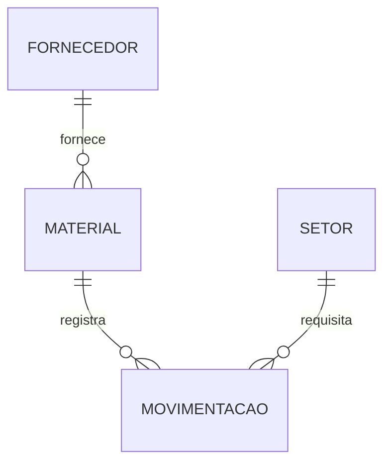

# Banco de Dados com MariaDB — Almoxarifado Industrial

Estudo de caso de **controle de estoque industrial** no **MariaDB**, com regras de negócio implementadas no próprio banco: custo médio ponderado, validação de saldo, numeração de requisições e auditoria automática de alterações.

> Material das disciplinas de Banco de Dados (ADS e Engenharia) — Prof. Eduardo Furlanetti.

## Estudo de caso

O almoxarifado de uma indústria compra **materiais** de **fornecedores** e os entrega aos **setores** produtivos por meio de requisições. Toda **movimentação** (entrada ou saída) atualiza o saldo e o custo médio do material.



## Recursos do MariaDB explorados

| Recurso | Para que serve aqui |
|---|---|
| `WITH SYSTEM VERSIONING` | guarda o histórico de cada alteração de saldo e custo — consulta com `FOR SYSTEM_TIME ALL` |
| `CREATE SEQUENCE` | gera o número das requisições de saída |
| `CREATE OR REPLACE PROCEDURE` | entrada e saída de material em transação, com `SIGNAL` para regra de negócio |
| `CHECK` com regra condicional | entrada exige custo; saída exige setor |
| Funções de janela e CTE | Kardex com saldo acumulado e **curva ABC** do consumo |

## Como executar

```bash
docker compose up -d
docker exec -it almoxarifado-mariadb mariadb -uroot -proot almoxarifado
```

Os scripts `01` a `03` são carregados na primeira inicialização. Em seguida:

```bash
docker exec -i almoxarifado-mariadb mariadb -uroot -proot --table < scripts/04_consultas.sql
```

Sem Docker, rode os scripts na ordem `01` → `04` em qualquer MariaDB 10.11 ou superior.

## Estrutura

```
scripts/
├── 01_schema.sql       # tabelas, sequence e tabela versionada
├── 02_procedures.sql   # sp_entrada e sp_saida
├── 03_dados.sql        # cadastro e movimentações de exemplo
└── 04_consultas.sql    # relatórios: kardex, curva ABC, histórico
exercicios/
├── lista.md
└── solucoes.sql
```

## Licença

[MIT](LICENSE)
